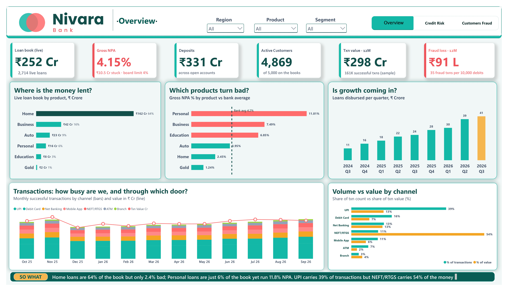

# 🏦 Nivara Bank — Retail & SME Performance Dashboard

**End-to-end Power BI project: credit risk · customer value · fraud · service SLAs**


> ⚠️ **Synthetic data notice:** Nivara Bank Ltd. is a **fictional** bank. All data in this repository is **synthetic**, generated for learning and portfolio purposes. No real customer, bank or transaction data is used.

---

## 📌 About the project
I built this dashboard to practise a full analytics workflow: take messy raw data, clean it, model it, and turn it into a dashboard that answers real business questions.

The scenario: leadership at a mid-sized Indian private bank (fictional) is worried about **rising NPAs**, **fraud**, and **flat customer growth**. The dashboard shows where the risk is coming from and what to do about it.

| | |
|---|---|
| **Data** | 6 related tables · 5,000 customers · 3,200 loans · 166,559 transactions · 1,800 complaints |
| **Tools** | Power BI Desktop · Power Query (M) · DAX |
| **Output** | 3-page interactive dashboard answering 10 business questions |
| **Headline result** | Gross NPA **4.15%**; Personal loans **~11.8%** |

## ❓ Business questions answered
| # | Question | Page |
|---|---|---|
| Q1 | How is the loan book split across products? | Overview |
| Q2 | What is Gross NPA overall and by product? How much is on the early-warning list? | Overview · Credit Risk |
| Q3 | Do credit score and EMI burden drive defaults? | Credit Risk |
| Q4 | Which branches and regions lend big but recover badly? | Credit Risk |
| Q5 | Which customer segments create the most value? | Customers · Fraud |
| Q6 | Who is dormant or leaving? | Customers · Fraud |
| Q7 | Where is the cross-sell gap? | Customers · Fraud |
| Q8 | How do transactions trend, and through which channels? | Overview |
| Q9 | Where and when does fraud happen? | Customers · Fraud |
| Q10 | Are complaints resolved within SLA? | Customers · Fraud |

## 🖼️ Dashboard
**1 · Overview**
[](page1.jpg)

**2 · Credit Risk**
)

**3 · Customers · Fraud · Service**
)

📄 Full 3-page PDF: [Nivara_BankLTD.pdf]([Nivara_BankLTD.pdf](https://github.com/hruturajwork-sys/Nivara-Bank-Powerbi/blob/main/Nivara_Bank_Dashboard.pdf))

## 🔍 Key findings
| Area | Finding |
|---|---|
| **Loan book** | ₹252 Cr live book. Home loans are ~64% of it and only ~2.4% bad |
| **NPA** | Gross NPA **4.15%** (₹10.5 Cr). Personal loans run **~11.8%**: ~6% of the book but ~18% of all NPA |
| **Drivers** | Credit score below 600 → **~20.9%** NPA vs ~1.0% at 750+. EMI above 50% of income → **~8.2%**, against ~1.7–2.3% when EMI is under 35% |
| **Early warning** | **₹14.5 Cr** is 31–90 days past due (the next NPA wave) |
| **Hotspots** | Hazratganj (~12.3%), Malviya Nagar, Hinjewadi. North × Personal is the worst region/product cell (~14.9%) |
| **Fraud** | **35 per 10,000** debits. Midnight–5am is ~3% of volume but ~11% of fraud. Net Banking (53) and Mobile App (49) are highest |
| **Customers** | Retail + SME create ~86% of value. Students are the most likely to go dormant or close (~14.7%). Only ~16% of Premium customers hold a fixed deposit |
| **Service** | ~37% of resolved complaints miss SLA; Account Opening Delay is worst (~56%) |

## ✅ Recommendations
1. **Cap EMI at 50% of income** and reprice or cut off scores below 650.
2. **Start collections at 30 days past due** so the watch-list doesn't turn into NPA.
3. **Add step-up authentication** for night-time, high-value online debits.
4. **Student → salary-account journey** and a fixed-deposit campaign for Premium customers.
5. **Fix onboarding delays** and review SLAs weekly at the slowest branches.

## 🧱 Data model
Star schema, with **one-to-many, single-direction** relationships:
- `dim_customers` → `dim_accounts`, `fact_loan`, `dim_complaints`
- `dim_accounts` → `fact_transaction`
- `dim_branch` → `fact_loan`, `dim_complaints`
- `dim_date` (calendar table) for monthly trends


| Table | Rows | Role |
|---|---|---|
| `dim_customers` | 5,000 | profile, segment, credit score |
| `dim_accounts` | 6,742 | deposit accounts, status, balance |
| `dim_branch` | 24 | branch, city, region |
| `dim_complaints` | 1,800 | complaints and SLA |
| `fact_loan` | 3,200 | loans, outstanding, days past due |
| `fact_transaction` | 166,559 | debits/credits, channel, fraud flag |
| `dim_date` | 365 | calendar |

## 🧹 Data cleaning (Power Query)
| Table | Issue found | Fix |
|---|---|---|
| customers | 40 duplicate customers | removed on `customer_id` |
| customers | gender `M / male / FEMALE` | standardised to Male / Female |
| customers | city case and spacing | trimmed, proper case |
| customers | impossible ages (0, 118, 999) | replaced with the median age of the occupation |
| customers | ~3% missing income | filled with occupation median |
| customers | blank credit scores | **kept as "No score"** (new-to-credit, not an error) |
| transactions | duplicate transaction IDs | removed |
| transactions | negative amounts | corrected with absolute value |
| transactions | blank merchant category | set to "Unknown" |
| loans | blank interest rates | filled with the product median |

## 📐 DAX highlights
```DAX
Gross NPA % = DIVIDE ( [NPA Cr], [Loan Book Cr] )

Bank GNPA % =
CALCULATE ( [Gross NPA %], ALL ( fact_loan ), ALL ( dim_customers ), ALL ( dim_branch ) )

Fraud per 10K = DIVIDE ( [Fraud Cases], [Debit Txns] ) * 10000

Risk Colour = IF ( [Gross NPA %] > [Bank GNPA %], "#FF6B6B", "#14B8A6" )
```
**Design choices**
- Gross NPA uses **outstanding amount**, not loan count, and excludes closed loans.
- Fraud is compared as a **rate per 10,000 debits**, not a raw count, to avoid volume bias.
- Blank credit scores are **not imputed**, because they mean "new to credit".
- Colour measures drive conditional formatting: **coral = above the bank average, teal = below**.

## 💡 Skills demonstrated
Data cleaning · Data modelling (star schema) · DAX (`CALCULATE`, `ALL`, `SWITCH`, `DIVIDE`) · Dashboard design · Banking KPIs (NPA, DPD buckets, SMA) · Insight writing and recommendations

## 📁 Repository structure
```
nivara-bank-powerbi/
├── Nivara_Bank_Dashboard.pbix      ← open in Power BI Desktop (data included)
├── Nivara_Bank_Dashboard.pbit      ← template (data not included)
├── Nivara_BankLTD.pdf              ← 3-page PDF export
├── screenshots/                    ← page1.png, page2.png, page3.png, model.png
├── data/raw/                       ← synthetic CSVs (6 tables)
├── cleaning_log.md
└── README.md
```

## ▶️ How to open
**Option A: the `.pbix` (easiest).** Download `Nivara_Bank_Dashboard.pbix` and open it in Power BI Desktop (free).

**Option B: the template.** Open `Nivara_Bank_Dashboard.pbit`. When asked for `DataFolder`, enter the path to the downloaded `data/raw/` folder, ending with a backslash, for example `C:\Users\you\Downloads\nivara-bank-powerbi\data\raw\`.

## ⚠️ Limitations
- The data is synthetic, so real data would be noisier and need more validation.
- One snapshot (30-Sep-2026): no roll-rate or time-trend analysis of NPA.
- Branch-level NPA is lumpy on small books, so read it next to loan book size.
- "Customer value" is a simple proxy: a 2.5% spread on deposits plus loan interest.

## 🔭 What I'd add next
Roll-rate analysis by month · provision coverage ratio · cost-to-income ratio · a SQL data layer · scheduled refresh.

## 👤 Author
**Hruturaj Sansare** · Aspiring Data Analyst
🔗 [LinkedIn](https://www.linkedin.com/in/hruturaj-sansare-549b64350/) · 📧 [Hruturajwork@gmail.com](mailto:Hruturajwork@gmail.com)

---
<sub>Nivara Bank Ltd. is fictional. All data is synthetic.</sub>
